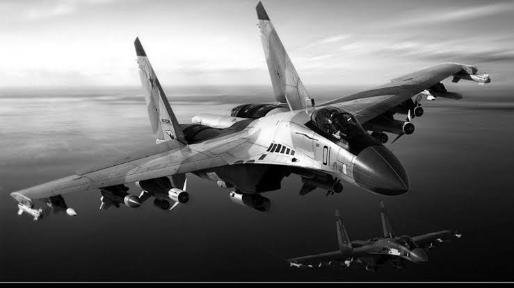
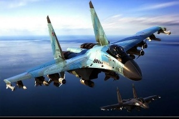
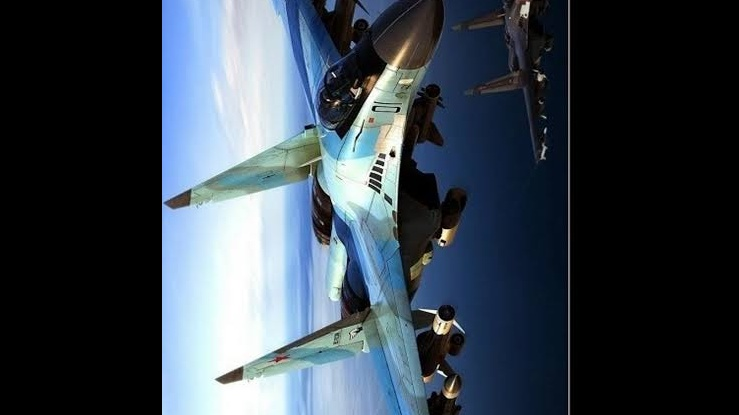
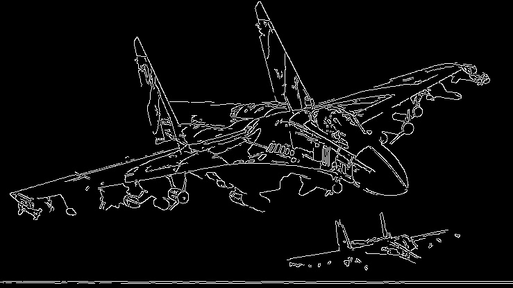
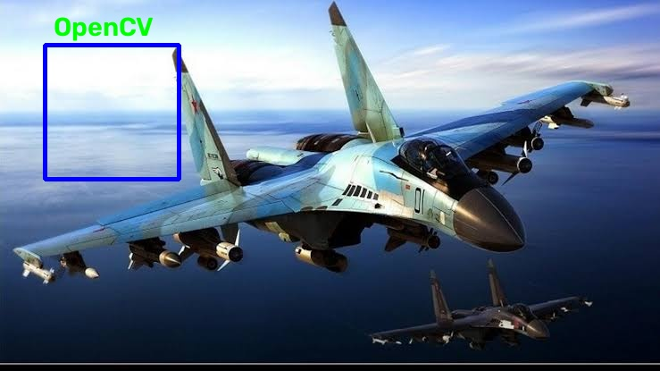
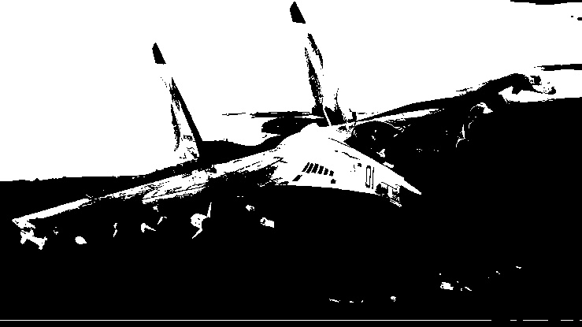
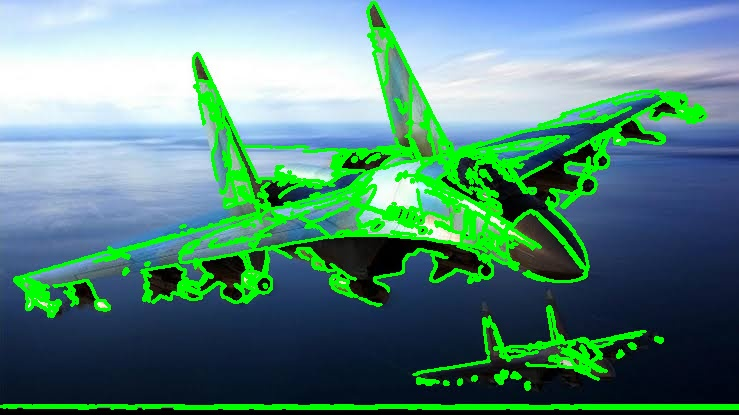
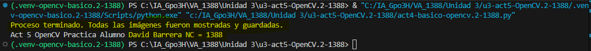

## operaciones basicas con opencv
## alumno David Barrera NC = 1388
# lectura de la imagen desde la carpeta
## 1. Imagen original

## 2. Escala de grises

## 3. Redimensionada

## 4. Rotada 90 grados

## 5. Desenfoque gaussiano

## 6. Bordes Canny

## 7. Rectangulo y texto

## 8. Umbralizacion binaria

## 9. Deteccion de contornos

## Confirmacion en terminal
